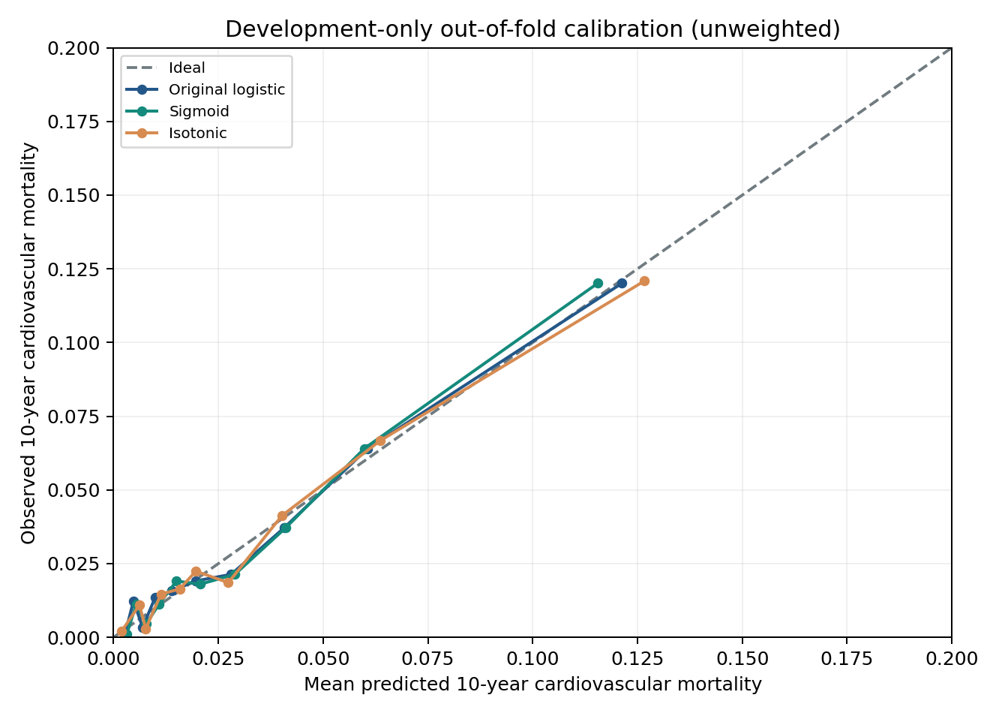

# Development-only calibration comparison v1

**Target:** 10-year cardiovascular mortality. **Cohort:** 8,902 NHANES 1999-2006 development participants, 274 events. **Status:** research analysis only. The 2007-2008 outcomes were not loaded or scored in this experiment.

The methods and conservative web-demo selection rule were written first in [calibration_plan_v1.md](calibration_plan_v1.md). Each reported calibrated probability is out-of-fold from five outer folds; its sigmoid or isotonic map was fitted with three inner folds. Preprocessing and the logistic model were also refit inside the relevant folds.

| Method | AUROC | AUPRC | Brier | Calibration intercept | Calibration slope | Mean predicted / observed |
| --- | ---: | ---: | ---: | ---: | ---: | ---: |
| Original logistic | 0.777 | 0.124 | 0.02841 | -0.125 | 0.958 | 3.08% / 3.08% |
| Sigmoid | 0.776 | 0.123 | 0.02843 | +0.026 | 1.009 | 3.08% / 3.08% |
| Isotonic | 0.774 | 0.116 | 0.02857 | -0.449 | 0.850 | 3.08% / 3.08% |

## Paired Brier differences from the original logistic model

Negative differences favor calibration. The 95% person-bootstrap intervals condition on the fixed out-of-fold predictions and omit model-fitting and NHANES-design uncertainty.

| Method | Brier difference (95% interval) |
| --- | ---: |
| Sigmoid | +0.000022 (-0.000022 to +0.000069) |
| Isotonic | +0.000154 (-0.000055 to +0.000393) |

**Selection under the written rule:** Original logistic.

The Brier score reflects discrimination as well as calibration; the plot and intercept/slope must be read alongside it. The later US cycle has been inspected for the original baseline, and neither this development result nor a later comparison makes the model safe for patient care. An independent target-population cohort is still needed.

[scikit-learn calibration guidance](https://scikit-learn.org/stable/modules/calibration.html)
